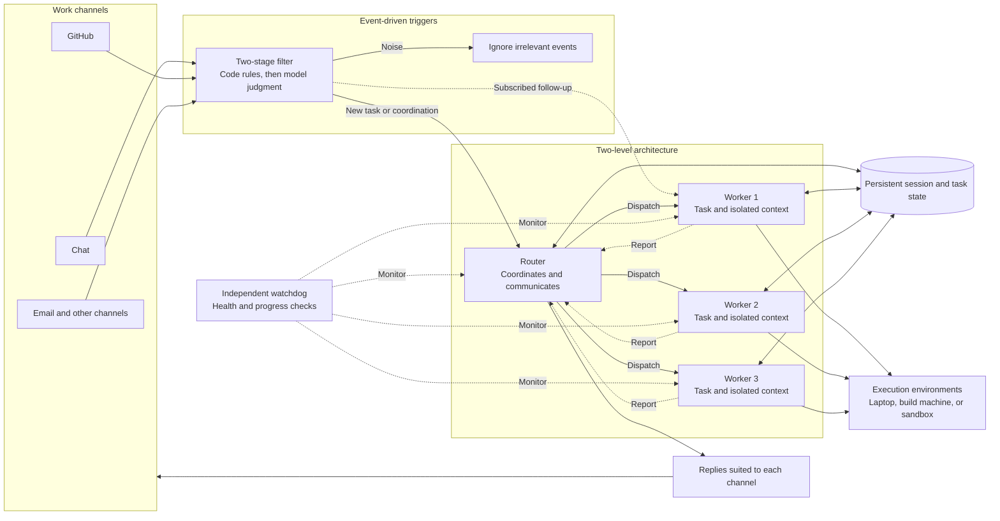
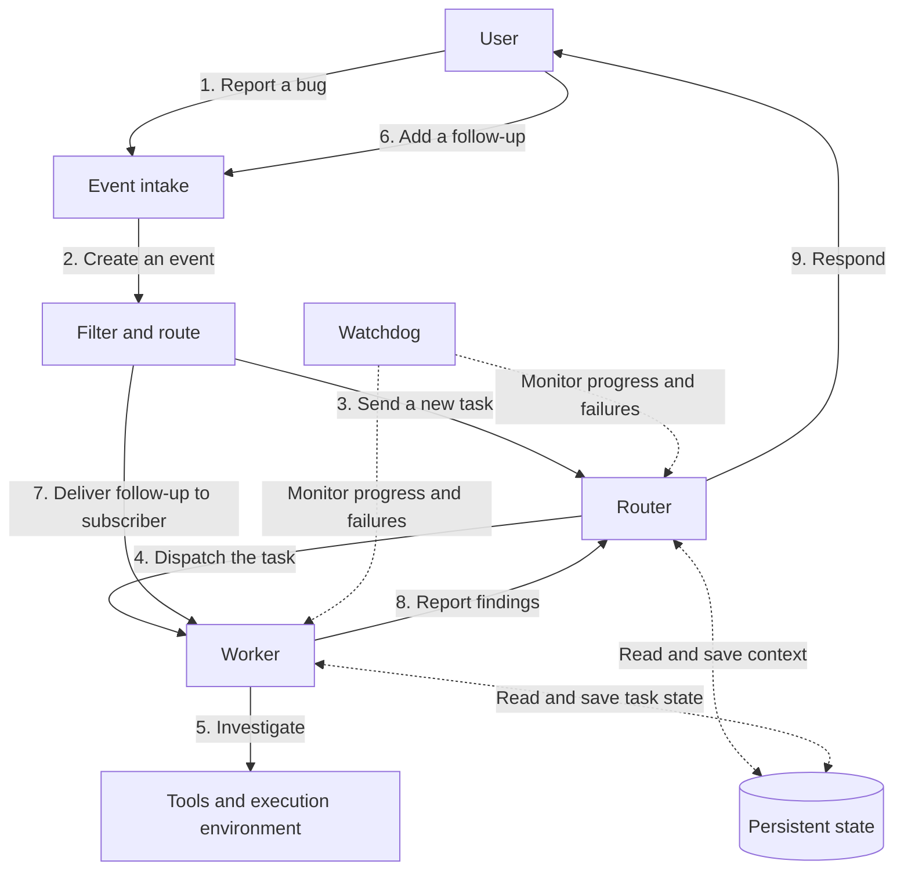

# Super Agent Architecture

This document captures our understanding of the architecture described in the DeepSeek Harness article. It is a starting point for discussion, not a description of an implemented system.

## Goal

As agents handle more work independently, managing many separate sessions can become a burden on human attention. The proposed super-agent manages that coordination and aims to be:

- **Continuous:** Maintains context across interactions and channels.
- **Productive:** Works on multiple tasks without blocking every interaction.
- **Proactive:** Responds to relevant events without requiring step-by-step instructions.
- **Persistent:** Maintains state and recovers from failures during long-running operation.

## The whole architecture

This overview follows the structure of the reference diagram. The named channels and machines are examples, not integrations that have been built.

The router can still observe subscribed follow-ups for global awareness; the direct path avoids requiring a fresh forwarding decision for each event. The router may use coordination and recall tools, while workers handle task execution. Long-running work is asynchronous so new input can be accepted while it runs. Persistent state is separate from the lifecycle of the agent loop, and execution environments can be separate from both.

The article groups these elements into five modules: **two-level architecture**, **event-driven triggers**, **full-duplex multi-channel interaction**, **separation of compute, state, and execution environments**, and an independent **watchdog**.

## Numbered data flow

The example below follows a user reporting a bug and adding a follow-up while a worker investigates.

1. **Report:** The user reports a bug.
2. **Intake:** The system records the message as an event.
3. **Route:** The system filters the event and sends the new task to the router.
4. **Dispatch:** The router creates a task and assigns a worker, which subscribes to the relevant thread.
5. **Investigate:** The worker uses tools in its execution environment.
6. **Follow up:** The user sends more information while the worker is running.
7. **Pass through:** The follow-up is delivered to the subscribed worker. The router can still see the event for global awareness, without having to make a new routing decision.
8. **Report:** The worker reports its findings to the router.
9. **Respond:** The router communicates the result to the user.

Persistent state supports the flow by storing information such as events, tasks, and subscriptions. The watchdog monitors for failures and stalled work. Both operate alongside the numbered sequence.

## Main components

- **Event intake and filtering:** Accept events from users or external systems and decide which need attention. The article describes deterministic filtering followed by semantic judgment when needed.
- **Router:** Coordinates tasks, maintains global continuity, and handles user-facing communication.
- **Workers:** Execute individual tasks in isolated contexts and report conclusions to the router.
- **Threads and subscriptions:** Associate related events with workers so follow-ups can reach them directly. A thread may have multiple subscribers, and a worker may subscribe to multiple threads.
- **Persistent state and context:** Store task history and relationships outside a single model context. Relevant details can be included in context or retrieved on demand.
- **Execution environments:** Provide the tools and resources workers need to perform their tasks.
- **Watchdog:** Independently checks system health and task progress and helps recover from failures.

## Initial scope to discuss

A possible first milestone is a local, single-user coding assistant that accepts tasks, runs separate workers, accepts follow-ups during work, and stores task history. The article also discusses multiple channels, cloud operation, remote environments, and proactive monitoring; those can be explored later.

Security, privacy, long-term memory, and coordination across trust boundaries remain open design questions.

## Source

Based on *Exploring Super-agent Design: Towards a More Autonomous Agent System* by the DeepSeek Harness team. See the [local article](DeepSeek-Super-Agent.pdf) or the [original post](https://x.com/DeepSeekHarness/status/2116857257245987236).
